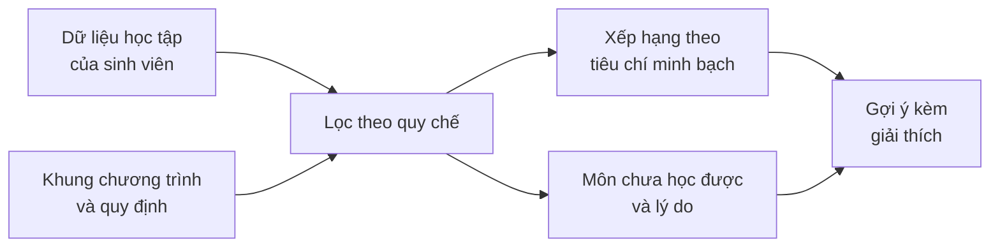

# AI-07 – Hệ thống gợi ý học phần có giải thích

*Explainable Course Recommender · Team SE2026-T24 · Nhóm SE.2026.14*

AI-07 giúp sinh viên đại học quyết định nên học những môn nào trong học kỳ tới. Hệ thống không chỉ đưa ra một danh sách môn học, mà còn nói rõ vì sao từng môn được gợi ý, và vì sao những môn khác chưa nên học. Gợi ý được cung cấp qua một API dùng chung, để các ứng dụng web và di động đều hiển thị cùng một kết quả và cùng một lời giải thích.

---

## Bối cảnh

Đến đợt đăng ký học phần, sinh viên phải tự xoay xở với khá nhiều thông tin cùng lúc. Môn nào còn bắt buộc phải học? Môn nào đã trượt và cần học lại? Môn nào chưa đủ điều kiện tiên quyết? Khối tự chọn nào đã đủ tín chỉ? Mình đang theo kịp tiến độ của chương trình hay đã chậm?

Phần lớn câu trả lời nằm rải rác trong khung chương trình đào tạo, bảng điểm và quy chế học vụ. Sinh viên thường phải tự đối chiếu bằng tay, hỏi bạn bè hoặc chờ cố vấn học tập. Kết quả là có người đăng ký môn chưa đủ điều kiện, có người bỏ sót môn cần học lại, có người chọn môn tự chọn chỉ vì bạn mình chọn.

Các công cụ gợi ý thông thường chỉ trả về một danh sách mà không giải thích. Với một quyết định ảnh hưởng tới cả lộ trình học, sinh viên cần hiểu lý do để tin và tự quyết định.

## Mục tiêu

1. **Gợi ý đúng quy chế.** Không bao giờ gợi ý một môn mà sinh viên chưa được phép học.
2. **Gợi ý hữu ích.** Ưu tiên những môn giúp sinh viên đi đúng tiến độ, gỡ được các môn đang nợ và phù hợp với thế mạnh của mình.
3. **Giải thích rõ ràng.** Mỗi gợi ý đi kèm lý do cụ thể, dựa trên chính dữ liệu của sinh viên, đủ để sinh viên kể lại bằng lời của mình.
4. **Dễ tích hợp.** Đối tác xây ứng dụng web hay di động chỉ cần gọi API, không phải tự cài lại logic gợi ý.

## Ai sử dụng

**Sinh viên** là người dùng chính. Họ muốn biết kỳ tới nên học gì, vì sao, và nếu thay đổi một vài giả định thì kết quả khác đi thế nào.

**Cố vấn học tập** dùng hệ thống để nắm nhanh tình hình của một sinh viên trước buổi tư vấn: đã tích lũy bao nhiêu tín chỉ, còn nợ môn nào, có đang chậm tiến độ không.

**Đối tác tích hợp** là các nhóm phát triển ứng dụng web và di động. Họ cần một API ổn định, có phiên bản rõ ràng, trả lỗi theo một định dạng thống nhất.

## Hệ thống làm được gì

- **Gợi ý học phần cho kỳ tới.** Một danh sách ngắn các môn nên học, xếp theo mức độ phù hợp, mỗi môn có lý do đi kèm.
- **Giải thích "vì sao chưa".** Với các môn không được gợi ý, hệ thống cho biết lý do: chưa đạt môn tiên quyết nào, khối tự chọn đã đủ, hay môn đó đã hoàn thành.
- **Xem tiến độ học tập.** Tín chỉ đã tích lũy, điểm trung bình, các môn đang nợ, so với kế hoạch của chương trình.
- **Thử "nếu… thì…" (what-if).** Sinh viên có thể giả sử mình sẽ đạt một môn, hoặc thay đổi mức ưu tiên giữa các tiêu chí, rồi xem danh sách gợi ý thay đổi ra sao. Dữ liệu gốc không bị ảnh hưởng.
- **Kiểm tra kế hoạch học kỳ.** Khi sinh viên tự chọn một nhóm môn, hệ thống báo nếu vượt số tín chỉ tối đa hoặc có môn chưa đủ điều kiện.
- **Xem quan hệ tiên quyết.** Một sơ đồ cho thấy môn nào mở khóa môn nào, giúp sinh viên nhìn ra những môn "then chốt".

## Gợi ý được tạo ra như thế nào

Hệ thống đi qua ba bước, mỗi bước có trách nhiệm riêng.

**Bước 1: lọc theo quy chế.** Từ khung chương trình và bảng điểm, hệ thống xác định trạng thái của từng môn: đã hoàn thành, cần học lại, học được, hay chưa đủ điều kiện. Đây là phần cứng nhắc nhất và phải đúng tuyệt đối, vì một gợi ý sai quy chế sẽ làm mất niềm tin vào toàn bộ hệ thống.

**Bước 2: xếp hạng.** Các môn học được được chấm điểm theo một số tiêu chí dễ hiểu, chẳng hạn:
- môn đang nợ cần gỡ;
- môn đúng hoặc đã trễ so với kỳ dự kiến;
- môn mở khóa nhiều môn khác;
- môn thuộc mảng sinh viên đang học tốt;
- môn thuộc chủ đề sinh viên quan tâm.

Mỗi tiêu chí có một trọng số, và người dùng có thể điều chỉnh trọng số này.

**Bước 3: giải thích.** Lời giải thích được dựng từ chính những tiêu chí đã đóng góp vào điểm, kèm số liệu thật như tên môn, điểm số, số tín chỉ. Vì vậy lời giải thích luôn khớp với thứ hạng, không có chuyện hệ thống "nói một đằng, làm một nẻo".

### Vì sao chọn cách tiếp cận dựa trên quy tắc

Nhóm chọn một mô hình xếp hạng dựa trên quy tắc và trọng số rõ ràng, thay vì một mô hình học máy "hộp đen" hay một mô hình ngôn ngữ lớn, vì ba lý do:
- **Minh bạch:** mọi gợi ý đều truy được về tiêu chí và dữ liệu đã tạo ra nó.
- **Ổn định:** cùng một đầu vào luôn cho cùng một kết quả, nên kiểm thử được một cách chặt chẽ.
- **An toàn:** các ràng buộc học vụ là luật, không phải thứ để một mô hình đoán.

Mô hình ngôn ngữ có thể được cân nhắc ở giai đoạn sau, nhưng chỉ để diễn đạt lời giải thích tự nhiên hơn, không được quyết định môn nào được gợi ý.

## Thế nào là một lời giải thích tốt

Nhóm dùng bốn tiêu chí để đánh giá lời giải thích:

- **Trung thực:** chỉ nói điều thực sự ảnh hưởng tới kết quả, không thêm lý do cho có.
- **Cụ thể:** nêu tên môn, điểm số, con số thật. Không viết chung chung kiểu "môn này phù hợp với bạn".
- **Hành động được:** nếu một môn chưa học được, sinh viên biết cần làm gì để học được.
- **Nhất quán:** cùng một tình huống thì cùng một cách diễn đạt, trên mọi nền tảng.

Ví dụ về lời giải thích mong muốn:

> *Nên học lại Giải tích 2: bạn chưa đạt môn này ở kỳ trước, và đây là điều kiện để học thêm nhiều môn của năm ba.*

> *Chưa học được Học máy: cần hoàn thành Xác suất thống kê trước.*

## Phạm vi

**Trong phạm vi:**
- Gợi ý các học phần còn lại trong chương trình đào tạo của chính sinh viên.
- Giải thích gợi ý và các môn chưa học được.
- What-if, kiểm tra kế hoạch học kỳ, sơ đồ tiên quyết.
- API có phiên bản và một giao diện web tham khảo.

**Ngoài phạm vi:**
- Gợi ý khóa học bên ngoài trường.
- Định hướng nghề nghiệp.
- Đăng ký học phần thật, xếp lịch học, phòng học.
- Dự đoán điểm hay khả năng qua môn.

Hệ thống chỉ hỗ trợ ra quyết định. Sinh viên luôn là người quyết định cuối cùng.

## Kiến trúc tổng quan

Hệ thống theo hướng **API-first**. Toàn bộ logic gợi ý nằm ở backend và được cung cấp qua một REST API có phiên bản. Giao diện web của nhóm chỉ là một ứng dụng sử dụng API như mọi đối tác khác.

Backend là một khối duy nhất nhưng chia thành các phần độc lập: truy cập dữ liệu, luật học vụ, xếp hạng, giải thích và lớp API. Các phần nghiệp vụ không phụ thuộc vào web server, nên có thể kiểm thử riêng từng phần. Cách chia này đủ đơn giản cho một nhóm sinh viên, nhưng vẫn cho phép thay một phần, ví dụ đổi cách xếp hạng, mà không ảnh hưởng phần còn lại.

Công nghệ dự kiến:

| Phần | Công nghệ |
| --- | --- |
| Backend | Python, FastAPI |
| Cơ sở dữ liệu | PostgreSQL |
| Giao diện web | React, TypeScript |
| Kiểm thử | pytest |
| Đóng gói và chạy | Docker, GitHub Actions |

## Dữ liệu

Hệ thống cần hai loại dữ liệu:

- **Dữ liệu chương trình đào tạo:** danh sách học phần, số tín chỉ, khối kiến thức, điều kiện tiên quyết, thang điểm và quy định về số tín chỉ mỗi kỳ. Loại dữ liệu này lấy từ văn bản chính thức của trường và được ghi lại nguồn gốc.
- **Dữ liệu học tập của sinh viên:** các môn đã học, điểm và trạng thái từng lần học, cùng thông tin sinh viên tự khai như chủ đề quan tâm.

Để bảo vệ quyền riêng tư, dự án **không sử dụng dữ liệu sinh viên thật**. Dữ liệu sinh viên được tạo giả lập theo các quy luật hợp lý, ví dụ: chỉ học môn khi đã đủ điều kiện, trượt thì học lại, không vượt số tín chỉ tối đa. Nhờ vậy dữ liệu vẫn sát thực tế mà không lộ thông tin cá nhân. Các thông tin nhạy cảm, nếu có, được tách riêng và chỉ dùng để kiểm tra tính công bằng, không bao giờ được đưa vào thuật toán gợi ý.
