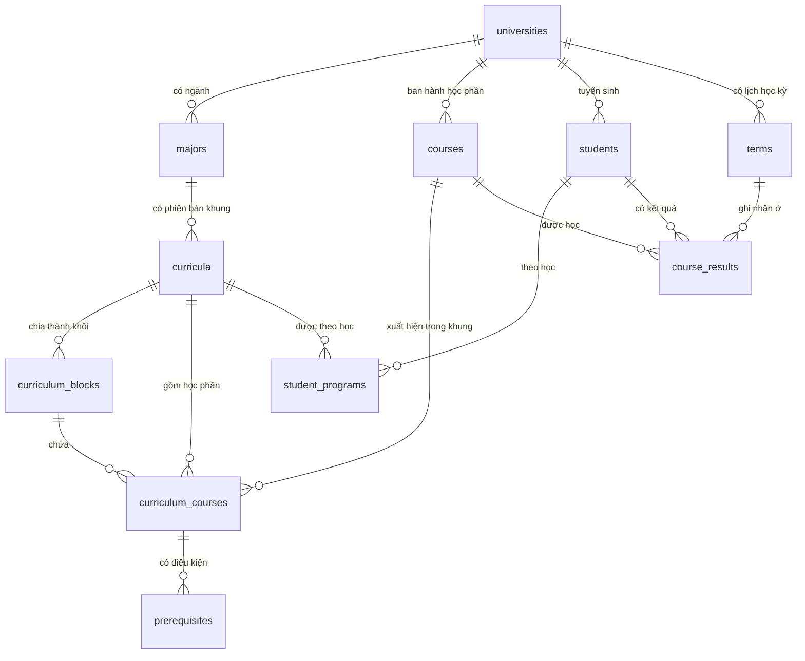

# Lược đồ dữ liệu

| | |
| --- | --- |
| Phiên bản lược đồ | `3.0.0` (`app_settings.schema_version`) |
| Nguồn sự thật | `src/data/db/schema.py` — SQLAlchemy Core, chạy trên PostgreSQL 16 |
| Bản SQL để đọc | `data/schema/schema_postgresql.sql` — sinh tự động, không chạy tay |
| Cửa duy nhất để đọc dữ liệu | `src/data/repository.py` |

Lý do chọn PostgreSQL cho mọi môi trường, chọn SQLAlchemy Core thay vì ORM, và chưa dùng công cụ
migration: xem `README.md` cùng thư mục. Tài liệu này chỉ mô tả *dữ liệu có hình gì*.

---

## 1. Quy ước

- Mọi bảng thực thể có khóa thay thế `id` kiểu số tự tăng. **`id` thay đổi mỗi lần nạp lại dữ liệu**,
  nên không bao giờ xuất hiện trong phản hồi API — hợp đồng API chỉ dùng mã nghiệp vụ.
- Mã nghiệp vụ (`code`, `student_code`…) duy nhất trong **phạm vi của nó**, thường là trong một trường,
  và không dùng làm khóa ngoại.
- Bảng liên kết nhiều-nhiều dùng khóa chính ghép, không có `id` riêng.
- Tên bảng số nhiều, `snake_case`, tiếng Anh. Tên cột trùng tên trường JSON trong hợp đồng API.
- Mỗi trường là một thế giới độc lập: ngành, học phần, thang điểm và lịch học kỳ đều thuộc về một trường.
  Vì vậy mọi truy vấn về sinh viên hay học phần đều phải đi kèm mã trường.

## 2. Quan hệ chính



Hai chỗ dễ nhầm:

- **Học phần thuộc trường, không thuộc khung.** `courses` là danh mục của cả trường; `curriculum_courses`
  mới nói học phần đó nằm trong khung nào, khối nào, kỳ thứ mấy. Một học phần xuất hiện trong nhiều khung.
- **Điều kiện tiên quyết thuộc khung, không thuộc học phần.** Cùng một học phần có thể yêu cầu điều kiện
  khác nhau ở hai chương trình đào tạo, vì mỗi văn bản tự quy định.

## 3. Các bảng

### Nguồn dữ liệu và chất lượng dữ liệu

| Bảng | Nội dung |
| --- | --- |
| `data_sources` | Văn bản đã dẫn ra dữ liệu: số quyết định, ngày ban hành, cơ quan ban hành |
| `data_issues` | Chỗ văn bản gốc mâu thuẫn hoặc thiếu, ghi lại thay vì âm thầm sửa |

### Tổ chức đào tạo

| Bảng | Nội dung |
| --- | --- |
| `universities` | Trường. `is_demo` đánh dấu trường giả lập chỉ dùng cho kiểm thử |
| `faculties` | Khoa |
| `majors` | Ngành đào tạo, mã theo Bộ GD&ĐT |
| `grading_schemes` | Thang điểm: `max_score`, `pass_score` — **mỗi trường một thang, không phải hằng số** |
| `grade_conversions` | Quy đổi điểm số sang điểm chữ và điểm thang 4 |

### Chương trình đào tạo

| Bảng | Nội dung |
| --- | --- |
| `curricula` | Khung CTĐT: một phiên bản của một ngành, áp dụng cho một dải khóa tuyển sinh |
| `curriculum_blocks` | Khối kiến thức, dạng cây qua `parent_block_id` |
| `courses` | Học phần của một trường, dùng chung cho mọi khung của trường đó |
| `curriculum_courses` | Học phần nằm trong khung nào, khối nào, kỳ dự kiến thứ mấy |
| `prerequisites` | Điều kiện của một học phần **trong một khung cụ thể** |
| `course_equivalences` | Học phần tương đương, thay thế |

`prerequisites` ghi `required_course_code` **nguyên văn**, còn `required_course_id` có thể rỗng khi văn bản
dẫn một mã không thuộc danh mục học phần của trường. Những mã đó được lọc khỏi kết quả truy vấn và chỉ
xuất hiện ở `data_issues`.

### Đặc trưng học phần

| Bảng | Nội dung |
| --- | --- |
| `skills`, `course_skills` | Kỹ năng học phần rèn luyện, kèm mức độ |
| `topics`, `course_topics` | Chủ đề học phần; mỗi học phần có **đúng một** chủ đề chính |

### Lịch học

| Bảng | Nội dung |
| --- | --- |
| `academic_years` | Năm học của một trường |
| `terms` | Học kỳ, mã dạng `NNNNK` (năm bắt đầu + số kỳ, `3` là kỳ hè) |
| `app_settings` | Cấu hình chạy: `target_term_code` (học kỳ đang gợi ý), `schema_version` |

### Sinh viên

| Bảng | Nội dung |
| --- | --- |
| `students` | Sinh viên. `is_synthetic` phân biệt dữ liệu giả lập |
| `student_programs` | Sinh viên theo học khung nào, khóa nào; cho phép chuyển ngành, song ngành |
| `student_attributes` | **Dữ liệu nhạy cảm**, chỉ dùng đánh giá công bằng |
| `student_interests` | Chủ đề sinh viên tự khai — tín hiệu **phụ** |
| `course_results` | Mỗi dòng là một lần học một học phần |
| `course_registrations` | Đăng ký học phần; với dữ liệu giả lập là đáp án để đo độ chính xác gợi ý |

Thuật toán gợi ý **không được đọc** `student_attributes`. Lớp `Repository` để bảng này sau một hàm riêng
`sensitive_attributes()` và không trả nó ở `students()`, để việc đọc nhầm phải là một hành động có ý thức.

### Lịch sử gợi ý (lược đồ có, v1 chưa ghi vào)

| Bảng | Nội dung |
| --- | --- |
| `recommendation_runs` | Một lần chạy gợi ý: thuật toán, phiên bản, trọng số (`JSONB`) |
| `recommendation_items` | Từng học phần được gợi ý: thứ hạng, điểm, lời giải thích (`JSONB`) |
| `recommendation_feedback` | Phản hồi của người dùng với một gợi ý |

## 4. Khóa nghiệp vụ

Cột dùng để tra dữ liệu từ CSV và từ API. Ngoài các khóa này, lược đồ còn hai chỉ mục duy nhất có điều
kiện: mỗi sinh viên tối đa **một** CTĐT chính, mỗi học phần đúng **một** chủ đề chính.

| Bảng | Khóa nghiệp vụ | Duy nhất trong |
| --- | --- | --- |
| `data_sources`, `universities`, `curricula`, `grading_schemes`, `skills`, `topics` | `code` | toàn hệ thống |
| `faculties`, `majors`, `academic_years`, `terms` | `code` | một trường |
| `courses` | `code` | một trường |
| `students` | `student_code` | một trường |
| `curriculum_blocks` | `code` | một khung |
| `curriculum_courses` | `course_id` | một khung |
| `prerequisites` | `group_no` + `required_course_code` | một học phần trong một khung |
| `grade_conversions` | `letter` | một thang điểm |
| `student_programs` | `curriculum_id` | một sinh viên |
| `course_results`, `course_registrations` | `course_id` + `term_id` | một sinh viên |
| `app_settings` | `key` | toàn hệ thống |

Mã khung có dạng `TRƯỜNG-MÃNGÀNH-KHÓA`, ví dụ `HUS-7480113QTD-2022`.

## 5. Tập giá trị hợp lệ

Các cột dưới đây bị ràng buộc `CHECK` trong lược đồ. Enum trong hợp đồng API phải là tập con của chúng.

| Cột | Giá trị |
| --- | --- |
| `majors.degree_level` | `bachelor`, `engineer`, `master`, `doctor` |
| `curricula.status` | `draft`, `active`, `retired` |
| `curriculum_blocks.selection_rule` | `all`, `choose_credits`, `container` |
| `prerequisites.requirement_type` | `prerequisite`, `prior`, `corequisite` |
| `terms.term_no` | `1`, `2`, `3` |
| `student_programs.status` | `active`, `graduated`, `suspended`, `withdrawn`, `transferred` |
| `course_results.status` | `passed`, `failed`, `exempted`, `withdrawn`, `in_progress` |
| `course_registrations.status` | `planned`, `registered`, `dropped` |
| `course_registrations.source` | `student`, `simulated`, `imported` |
| `data_issues.status` | `open`, `resolved_in_data`, `closed` |
| `recommendation_feedback.action` | `viewed`, `accepted`, `rejected`, `registered` |

`counts_toward_total = false` ở `curriculum_blocks` nghĩa là khối không tính vào tổng tín chỉ tốt nghiệp
(Giáo dục thể chất, Giáo dục quốc phòng – an ninh, Kỹ năng bổ trợ). Mọi phép tính tiến độ phải tôn trọng cờ này.

## 6. View

`src/data/db/views.py` khai báo các view được dựng lại cùng lược đồ. Chúng gom sẵn những phép nối lặp
lại nhiều lần, để câu truy vấn trong `Repository` ngắn và đọc được.

| View | Nội dung |
| --- | --- |
| `v_curriculum_courses` | Học phần của khung kèm khối, quy tắc chọn, kỳ dự kiến |
| `v_prerequisites` | Điều kiện tiên quyết kèm cờ `in_curriculum` (mã có thuộc khung hay không) |
| `v_student_programs` | Sinh viên kèm khung đang theo học |
| `v_course_results` | Kết quả học tập kèm mã học kỳ; `recency = 1` là lần học gần nhất |
| `v_student_progress` | Tín chỉ tích lũy, tín chỉ đang nợ, điểm trung bình thang 4 |

View không nhận tham số, nên `v_course_results` và `v_student_progress` luôn tính trên **mọi** học kỳ.
`Repository.student()` cần tính trên các học kỳ trước một học kỳ cho trước (mục 3.1 của hợp đồng API), nên
chép công thức của `v_student_progress` vào một câu truy vấn có tham số. `test_repository.py` kiểm hai bản
cho cùng kết quả ở học kỳ cần gợi ý; sửa công thức ở view thì sửa cả bản trong `repository.py`.

## 7. Đọc dữ liệu qua `Repository`

Tầng nghiệp vụ và tầng API **chỉ** gọi các hàm dưới đây; không có câu SQL nào nằm ngoài `src/data/`.
Mọi hàm trả về `pandas.DataFrame`, trừ nơi ghi khác.

| Hàm | Trả về |
| --- | --- |
| `setting(key)` | Một giá trị cấu hình (chuỗi) |
| `universities()` | Danh sách trường |
| `terms(university_code)` | Lịch học kỳ của một trường, cũ đến mới |
| `term(university_code, term_code)` | Một học kỳ trong lịch của trường đó (một dòng); `KeyError` khi không có |
| `target_term(university_code)` | Học kỳ đang gợi ý, trong lịch của chính trường đó (một dòng) |
| `curricula()` | Mọi khung kèm thang điểm và giới hạn tín chỉ mỗi kỳ |
| `curriculum(code)` | Một khung (một dòng) |
| `curriculum_courses(code)` | Học phần của khung; cột `prerequisite_groups` là `list[list[str]]` |
| `prerequisite_graph(code)` | `(nodes, edges)` của sơ đồ tiên quyết; gom `edges` theo nhóm ra đúng `prerequisite_groups` |
| `blocks(code)` | Mọi khối của khung, kèm `parent_block_code` |
| `elective_blocks(code)` | Chỉ các khối tự chọn (`choose_credits`) |
| `students(only_primary=True)` | Sinh viên kèm tiến độ, môn đã đạt, môn đang nợ, lần học gần nhất, sở thích |
| `student(university_code, student_code, term_code=None)` | Một dòng như `students()`, chỉ tính các học kỳ trước `term_code`; `None` khi không có CTĐT chính |
| `student_programs(university_code, student_code)` | Mọi CTĐT của một sinh viên; rỗng khi không có sinh viên này |
| `block_progress(student_id, term_code=None)` | Tín chỉ cần và đã đạt theo từng khối, cùng mốc học kỳ với `student()` |
| `course_results(student_id=None)` | Kết quả học tập từng lần học |
| `registrations(term_code=None)` | Đăng ký học phần |
| `data_issues()` | Các chỗ văn bản gốc mâu thuẫn, kèm văn bản nguồn |
| `sensitive_attributes()` | **Chỉ** cho đánh giá công bằng |

Hai lưu ý khi dùng:

- `prerequisite_groups` là **hai tầng**: các nhóm nối với nhau bằng VÀ, các mã trong cùng nhóm bằng HOẶC.
  Làm phẳng cấu trúc này biến HOẶC thành VÀ, tức là đọc sai quy chế.
- Cột không có giá trị trả về `NaN` của pandas chứ không phải `None` — tầng API phải đổi sang `null`
  trước khi trả JSON.

## 8. CSV là nguồn, database là bản dựng

Dữ liệu sống trong CSV đã commit vào repo; database được dựng lại từ CSV bằng một lệnh. Vì vậy mất
database không mất dữ liệu.

| Thư mục | Nội dung |
| --- | --- |
| `data/seed/` | Dữ liệu chương trình đào tạo, lấy từ văn bản của trường |
| `data/synthetic/` | Sinh viên giả lập, sinh bằng `tools/generate_synthetic.py` |
| `test/fixtures/seed_demo/` | Một trường giả lập có thang điểm riêng, để lộ chỗ viết cứng |
| `test/fixtures/students/` | Sinh viên kiểm thử cố định kèm đáp án |

CSV dùng **mã tự nhiên** thay cho `id` để người đọc hiểu được và sửa được bằng tay; khi nạp, mã được đổi
sang `id` của bảng đích. Thứ tự nạp do `LOAD_ORDER` trong `build.py` quyết định, nên nhiều thư mục ghép
được với nhau và một thư mục chỉ cần chứa một phần các file.

Khối kiến thức nạp hai bước: chèn mọi khối trước, gán `parent_block_id` sau, vì khối cha và khối con nằm
trong cùng một file.

```bash
python -m tools.build_db                      # dựng lại database đang trỏ tới từ CSV
python -m tools.build_db --dirs data/seed      # chỉ dữ liệu chương trình đào tạo
```

## 9. Đổi lược đồ

1. Sửa `src/data/db/schema.py` — đây là nguồn sự thật duy nhất.
2. Tăng `schema_version` trong `data/seed/app_settings.csv` khi cấu trúc bảng đổi. Hợp đồng API trả giá
   trị này ở `GET /v1/meta`, nên client biết database đang ở phiên bản nào.
3. Bỏ một bảng thì thêm tên nó vào `RETIRED_TABLES` trong `src/data/db/build.py`, để database dựng từ
   phiên bản cũ được dọn đúng cách. Hiện danh sách này chứa bốn bảng về nghề nghiệp đã bỏ ở `3.0.0`.
4. Sinh lại các file dẫn xuất rồi commit kèm trong cùng pull request:

```bash
python -m tools.export_schema        # data/schema/schema_postgresql.sql
python -m tools.generate_synthetic   # data/synthetic/*.csv
python -m tools.generate_fixtures    # test/fixtures/students/*.csv
```

CI sinh lại đúng ba lệnh trên rồi chạy `git diff --exit-code`: file dẫn xuất lệch khỏi code sinh ra chúng
thì build đỏ.

Lựa chọn "không dùng migration" chỉ còn đúng khi dữ liệu sinh lại được. Khi hệ thống bắt đầu lưu dữ liệu
cần giữ — lịch sử gợi ý, phản hồi người dùng — nâng cấp lược đồ sẽ cần một công cụ migration.
