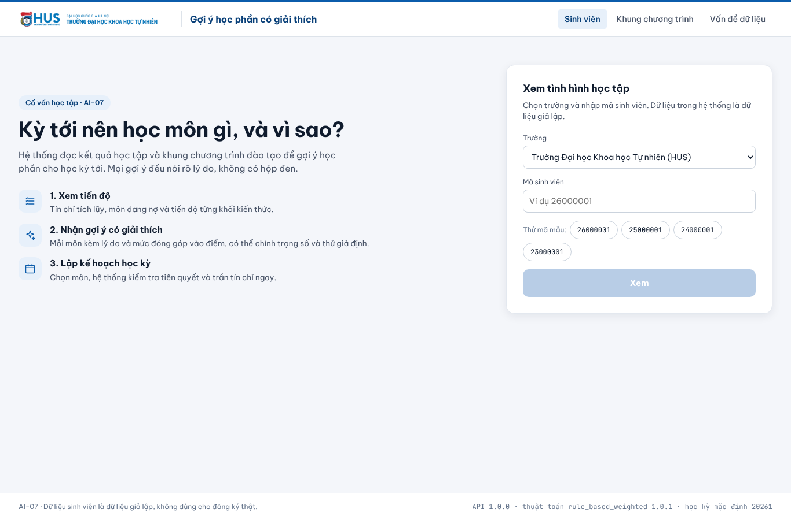
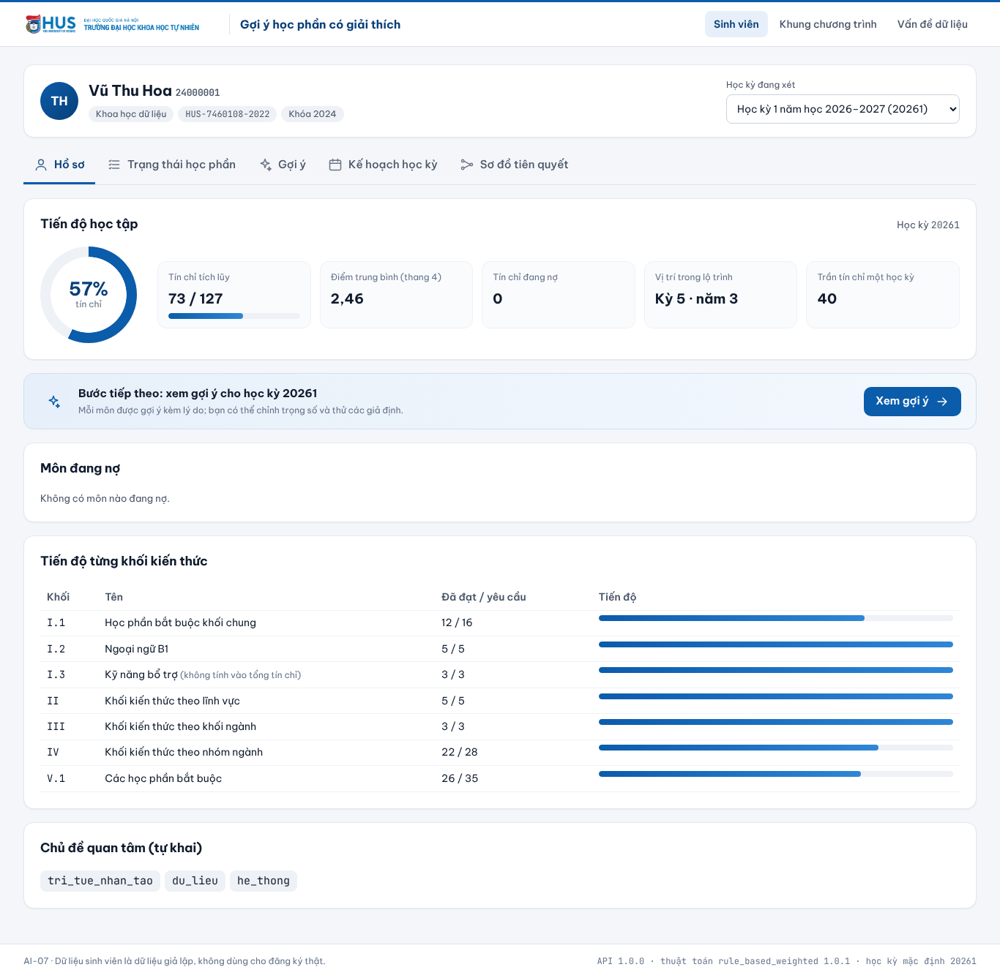
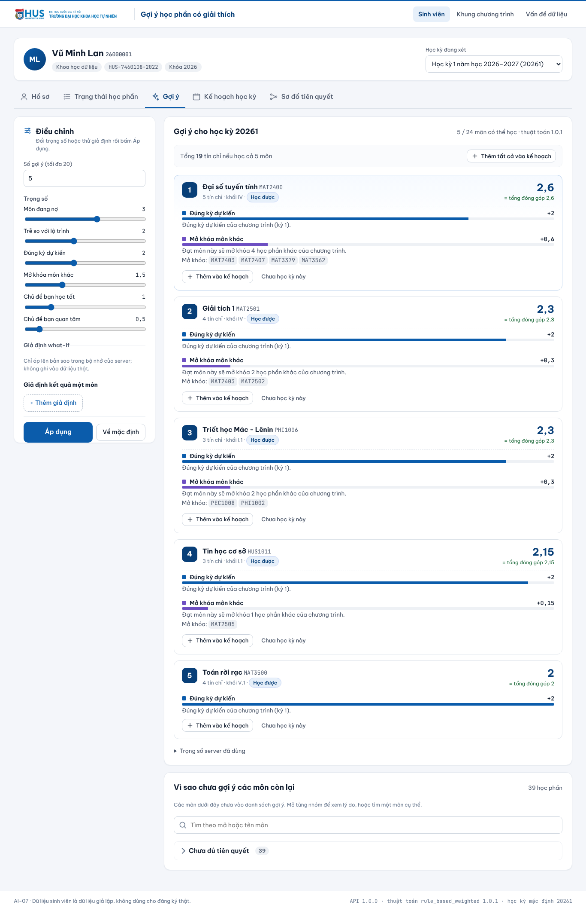
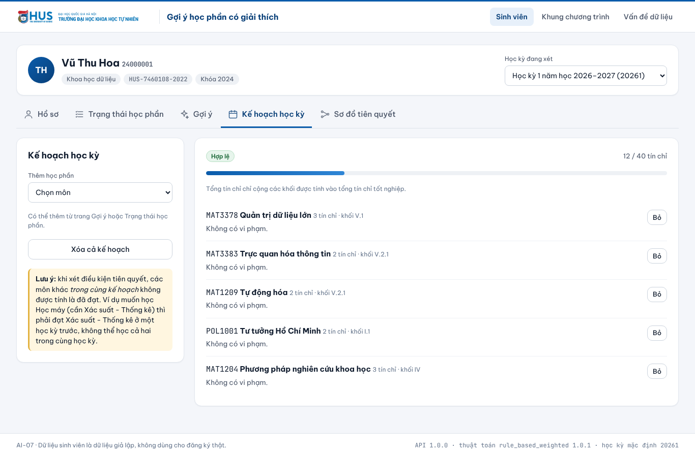
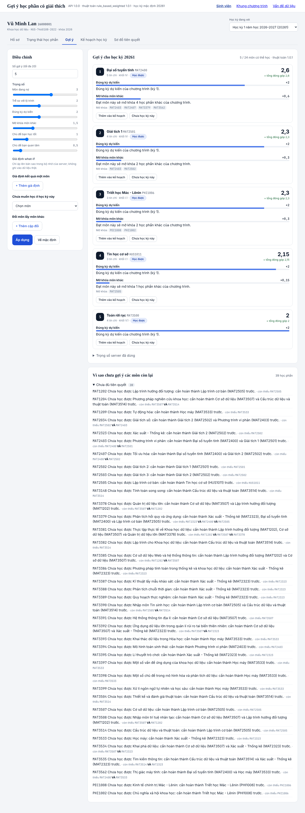
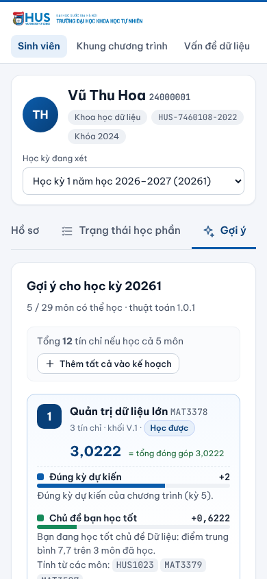

# Làm mới giao diện web (UX refresh)

Nhánh `feat/fe-ux-hus`, dựng trên `feat/web-student-screens` (WEB-2..4, #17).

## Vì sao không dùng nhánh `feat/fe-hus-ui`

`feat/fe-hus-ui` thay FE bằng bản cũ gọi `/catalog/courses`, `/recommendations`, `/why-not` với kiểu dữ liệu gõ tay.
Các đường dẫn này không có trong [`docs/api/openapi.json`](../api/openapi.json) hiện tại trên `main`
(sau commit `36c97f0` sửa API sinh viên). Vì vậy chỉ lấy **logo và màu nhận diện HUS** từ nhánh đó; tầng API
giữ nguyên bản sinh tự động từ `openapi.json` (`npm run check:api` qua).

## Thay đổi

| Chỗ | Trước | Sau | Nguyên tắc |
| --- | --- | --- | --- |
| Header | Chữ, link gạch chân, phiên bản API chen giữa | Logo HUS, viền xanh HUS, nav dạng pill, header dính khi cuộn; phiên bản API/thuật toán chuyển xuống footer (vẫn hiện, §6.1) | Nhận diện thương hiệu, giảm nhiễu (Nielsen #8) |
| Trang chọn SV | Một form trơn | Landing 2 cột: câu hỏi chính, 3 bước của hệ thống, form; nút mã mẫu mỗi khóa | Cho người mới biết hệ thống làm gì (onboarding) |
| Đầu trang SV | Tên + dòng chữ nhỏ | Avatar chữ cái đầu, chip ngành/CTĐT/khóa; tab có icon, dính khi cuộn, cuộn ngang trên mobile | Định hướng: luôn biết mình đang ở đâu |
| Hồ sơ | 5 số liệu một hàng | Vòng tiến độ % tín chỉ, thẻ số liệu, nợ tín chỉ tô cam; khối "Bước tiếp theo" dẫn sang Gợi ý | Giống degree audit (DegreeWorks, Stellic): tiến độ trước, hành động kế tiếp rõ |
| Trạng thái học phần | 63 dòng dài, mọi nhóm mở | Chip lọc theo trạng thái có đếm, ô tìm kiếm có icon, nhóm thu gọn mặc định trừ "Cần học lại"/"Học được", viền màu theo nhóm | Progressive disclosure, giảm tải nhận thức |
| Gợi ý | Danh sách "vì sao chưa" 39 dòng luôn mở | Tổng tín chỉ + "Thêm tất cả vào kế hoạch"; màu riêng cho từng loại lý do; "vì sao chưa" thu gọn + tìm kiếm; bảng điều chỉnh dính bên trái, nút Áp dụng dính đáy | Giải thích gợi ý: tóm tắt trước, chi tiết khi cần |
| Kế hoạch | "Kế hoạch đang trống" | Trạng thái rỗng có hướng dẫn và nút sang Gợi ý; thanh tín chỉ đỏ khi vượt trần | Empty state có hành động |
| Mobile | Tràn ngang ở trang Gợi ý | Không tràn ở 390px trên mọi trang; kết quả gợi ý lên trước, bảng điều chỉnh xuống dưới | Mobile-first |
| Khác | | Skip link, focus ring rõ, skeleton khi tải, tôn trọng `prefers-reduced-motion`, font Be Vietnam Pro | WCAG 2.2 AA |

Không đổi logic, không đổi cách gọi API; mọi con số vẫn đến từ server.

## Kiểm tra

`npm run lint`, `npm test` (70 test), `npm run build`, `npm run check:api` qua. Chạy live với backend trên
`data/seed`, kiểm tra `scrollWidth` = 390 ở 8 trang trên khung 390px.

## Ảnh

| | |
| --- | --- |
|  |  |
|  |  |
|  |  |
