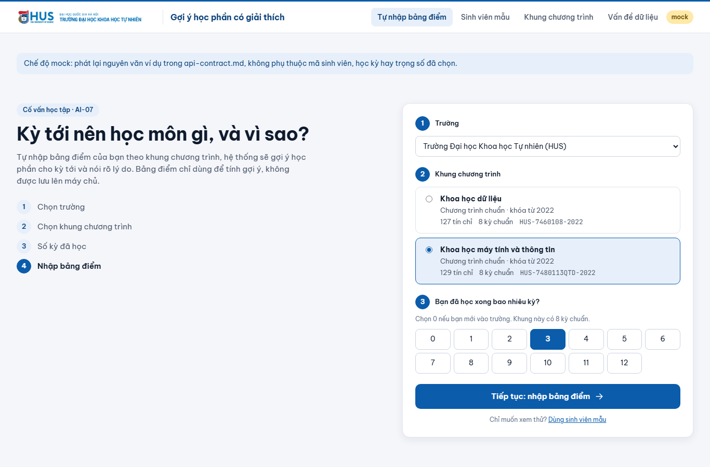
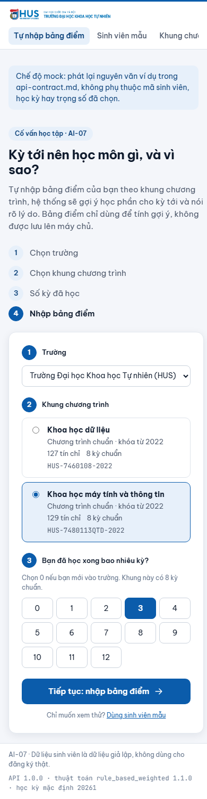

# WEB-5: wizard tự nhập bảng điểm, bước 1–3 (#39)

Nhánh `feat/web-transcript-wizard`. Phụ thuộc `DATA-3` (đã vào `main` qua PR #40).

## Đã làm

- Trang chủ `/` là wizard (`src/web/src/pages/TranscriptWizardPage.tsx`):
  1. Chọn trường từ `GET /v1/universities`. Nếu chỉ có một trường thì chọn sẵn.
  2. Chọn khung từ `GET /v1/universities/{uni}/curricula`. Mỗi khung là một thẻ radio hiện tên ngành,
     tên chương trình, khóa áp dụng, tổng tín chỉ, số kỳ chuẩn và mã khung. Mọi số liệu lấy nguyên từ server.
  3. Chọn số kỳ đã học, từ 0 đến 12 (§6.10 `semesters_completed`).
- Lựa chọn nằm trên query string `?uni=…&curriculum=…&ky=…` (`src/web/src/lib/wizard.ts`), nên khi tải lại trang,
  bấm Back hay chuyển sang bước 4 thì đọc lại được, không cần state chung. Nếu `ky` không phải số nguyên trong [0, 12]
  thì coi như chưa chọn. Khung không thuộc trường thì hiện cảnh báo và không cho tiếp tục.
- Nút "Tiếp tục: nhập bảng điểm" dẫn sang `/bang-diem?…`. Trang này hiện chỉ là chỗ đứng cho WEB-6. Vào thẳng
  khi chưa chọn đủ ba bước thì quay về wizard.
- Thanh điều hướng có "Tự nhập bảng điểm" (`/`) và "Sinh viên mẫu" (`/students`). Luồng nhập mã sinh viên cũ
  và các màn `/students/:uni/:student/...` giữ nguyên.
- Đã chạy `npm run gen:api` vì `openapi.json` trên `main` đã có thêm schema của #36.
- Test: `src/web/src/test/wizard.test.tsx` gồm 8 test: đi hết bước 1–3 trên mock, đọc lại từ URL, chọn 0 kỳ,
  khung sai, lỗi API, chặn `/bang-diem` khi chưa đủ, link "Sinh viên mẫu", và kiểm tra `readChoice`/`choiceQuery`.

Kết quả kiểm tra: `npm test` (78/78), `npm run lint`, `npm run check:api` và `npm run build` đều chạy qua.

## Ảnh chụp (mock)

| Desktop 1366px | Mobile 390px |
| --- | --- |
|  |  |

## Việc tiếp theo

- WEB-6 (`feat/web-transcript-entry`): thay chỗ đứng `/bang-diem` bằng danh sách môn từ `.../courses`,
  ô điểm, nút "Miễn", kỳ học, và tóm tắt qua `POST .../transcript`.
- Nút "Tiếp tục" chỉ đổi URL. Bảng điểm sẽ lưu vào localStorage ở WEB-8.
