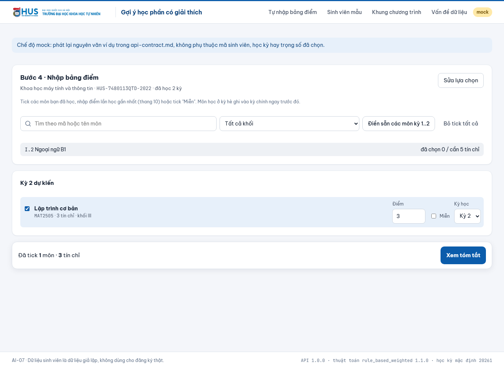
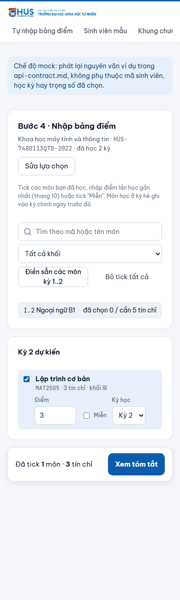

# WEB-6: nhập bảng điểm (#39)

Nhánh `feat/web-transcript-entry`, tách từ `feat/web-transcript-wizard` (WEB-5, PR #42). Cần merge #42 trước.

## Đã làm

- `/bang-diem?uni=…&curriculum=…&ky=N` (`src/web/src/pages/TranscriptEntryPage.tsx`):
  - Danh sách môn lấy từ `GET .../curricula/{code}/courses`, nhóm theo `recommended_semester`. Môn không có kỳ dự kiến
    nằm ở nhóm "Chưa xếp kỳ" cuối trang. Có thể lọc theo khối và tìm theo mã hoặc tên.
  - Nút "Điền sẵn các môn kỳ 1..N" tick các môn có kỳ dự kiến ≤ N, kỳ học bằng kỳ dự kiến, và giữ nguyên các môn đã tick.
    Có thể bỏ tick từng môn, hoặc dùng "Bỏ tick tất cả".
  - Mỗi môn đã tick có ô điểm (0 tới `max_score` của khung, bước 0,1), hộp "Miễn" và ô chọn kỳ học 1..N.
  - Khối `choose_credits` hiện "đã chọn X / cần Y tín chỉ". X chỉ là tổng tín chỉ các môn đã tick, client không
    quyết định đạt hay trượt.
  - "Xem tóm tắt" gọi `POST .../transcript` (§6.10) rồi hiện tín chỉ tích lũy, GPA, tín chỉ nợ, số môn đạt, môn đang
    nợ, `warnings`, tiến độ từng khối và câu `text` của từng môn. Mọi con số và câu chữ trong phần này lấy từ server.
  - Lỗi 422: `details.fields` được đổi về đúng ô, ví dụ `results[3].score` là dòng thứ 4 của body. Body xếp theo thứ
    tự danh sách môn của khung, `codes[i]` là mã môn của `results[i]` (`fieldTarget()` trong
    `src/web/src/lib/transcriptDraft.ts`). Đường dẫn không thuộc dòng nào, như `semesters_completed`, thì hiện
    trong khung lỗi chung.
  - Môn đã tick mà chưa có điểm và chưa tick "Miễn" thì chưa gửi request, ô đó được đánh dấu đỏ.
  - `ky=0`: không có danh sách môn, "Xem tóm tắt" gửi `results: []`.
- Bản nháp được lưu vào localStorage theo trường và khung (đã bọc try/catch), cùng dạng body §6.10. Nhờ vậy bấm
  "Sửa lựa chọn" rồi quay lại vẫn còn dữ liệu. Phần này làm sớm một phần của WEB-8. Xuất và nhập file JSON vẫn để
  cho WEB-8, nhưng `fromBody()` đã đọc được file trong `test/fixtures/transcripts/` (có test).
- `ApiClient.transcript()`: bản live gọi `POST /universities/{uni}/curricula/{code}/transcript`, bản mock trả nguyên
  ví dụ §6.10. Ba khối JSON của §6.10 được chép vào `src/web/src/api/mocks/contract/transcript*.json`, và
  `contract-fixtures.test.ts` kiểm tra chúng khớp hợp đồng.
- **Tạm thời:** `openapi.json` chưa có endpoint này (API-4, #38), nên kiểu §6.10 đang khai báo tay trong
  `src/web/src/api/transcript.ts`. Khi API-4 merge thì chạy `npm run gen:api`, chuyển sang kiểu sinh tự động rồi xóa file đó.

Kiểm tra: `npm test` qua 91/91 (`transcript.test.tsx` có 12 test mới); `lint`, `check:api` và `build` cũng qua.

## Ảnh chụp (mock)

Mock §6.3 chỉ có một học phần (MAT2505), nên trên mock danh sách rất ngắn. Test dùng danh sách môn tự dựng.
Muốn demo đủ 65 môn thì cần chạy live (backend và PostgreSQL).

| Desktop 1366px | Mobile 390px |
| --- | --- |
|  |  |

## Việc tiếp theo

- WEB-7: màn gợi ý và what-if (`POST .../curricula/{code}/recommendations`, §6.11), có nút "Quay lại sửa bảng điểm".
- WEB-8: xuất và nhập file JSON, chạy `gen:api` khi có API-4/API-5, chụp ảnh luồng đầy đủ trên live.
