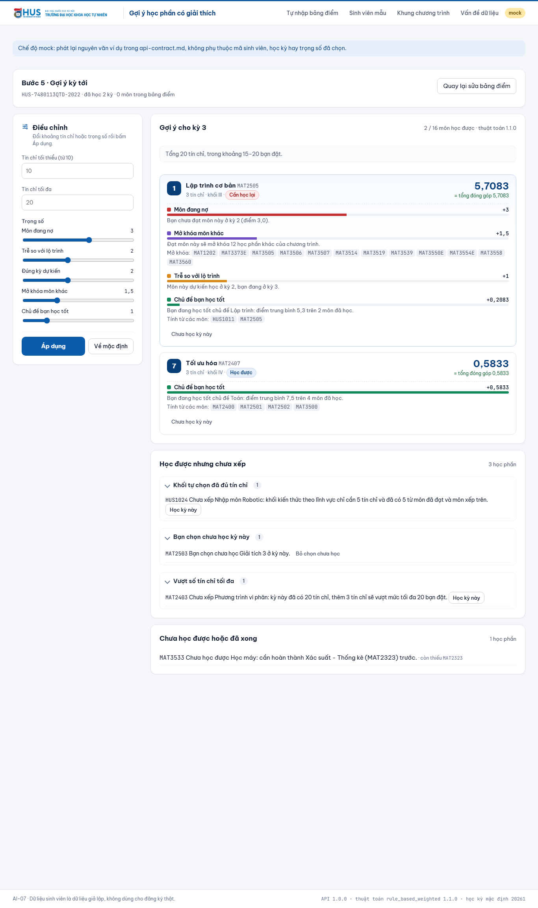
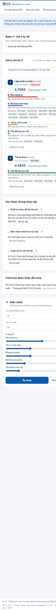

# WEB-7: gợi ý và what-if cho bảng điểm tự nhập (#39)

Nhánh xếp chồng trên WEB-6 (PR #46). Cần merge #42 và #46 trước.

## Đã làm

- `/goi-y?uni=…&curriculum=…&ky=N` (`src/web/src/pages/TranscriptRecommendationsPage.tsx`), bước 5 của wizard.
  Vào từ nút "Xem gợi ý cho kỳ X" trong phần tóm tắt của bước 4; nút "Quay lại sửa bảng điểm" về `/bang-diem`.
- Bảng điểm lấy từ bản nháp localStorage của bước 4, dựng body bằng `toBody()` như §6.10, rồi gọi
  `POST .../curricula/{code}/recommendations` (§6.11).
- Điều chỉnh: `min_credits`, `max_credits` (để trống thì server dùng mặc định), trọng số (không có thanh
  `interest` vì §6.11 quy định 10 không bao giờ trả lý do này), bấm "Áp dụng".
- What-if: "Chưa học kỳ này" trên một gợi ý gửi `skip`; "Học kỳ này" trên một môn chưa xếp gửi `include`.
  Một mã chỉ ở một trong hai danh sách. Hai danh sách hiện thành chip trong khung Điều chỉnh để bỏ chọn.
  `what_if = true` thì hiện băng "kịch bản giả định".
- Kết quả: câu `credit_window.text`, `items` kèm bảng lý do và kiểm tra tổng đóng góp (dùng lại `ReasonList`,
  `ScoreCheck`), `not_selected` nhóm theo `reason` (§4.6) kèm `text`, `not_eligible` kèm tiên quyết còn thiếu,
  `warnings` (gồm `below_min_credits`). Mọi con số và câu chữ lấy từ server.
- Lỗi 422: `results[i]` đổi về mã môn trong bảng điểm và có nút "Sửa bảng điểm"; `skip[i]`/`include[i]` đổi về
  mã đã chọn.
- `ApiClient.recommendTranscript()` live + mock. Mock phát lại nguyên ví dụ §6.11, chỉ `what_if` theo request.
  Hai khối JSON của §6.11 nằm trong `api/mocks/contract/transcript-recommendations*.json`, có test khớp hợp đồng.
- **Tạm thời:** kiểu §6.11 khai báo tay trong `src/web/src/api/transcript.ts` cho tới khi API-5 (#38) vào
  `openapi.json`.

Kiểm tra: `npm test` 96/96 (`transcript-recs.test.tsx` có 4 test mới); `lint`, `check:api`, `build` qua.

## Ảnh chụp (mock)

Mock trả nguyên ví dụ rút gọn của §6.11 nên chỉ có 2 gợi ý và mỗi lý do chưa xếp một môn.

| Desktop 1366px | Mobile 390px |
| --- | --- |
|  |  |

## Việc tiếp theo

- WEB-8: xuất và nhập file JSON, chạy `gen:api` khi có API-4/API-5, chụp ảnh luồng đầy đủ trên live.
