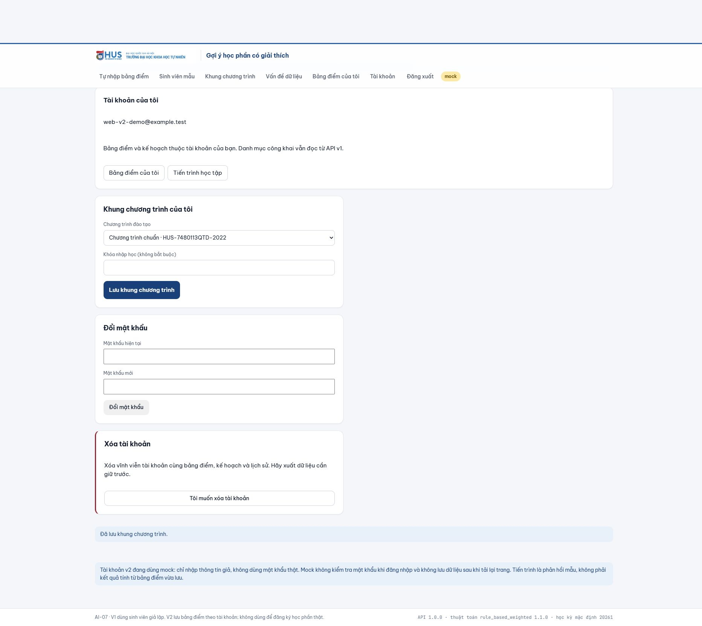
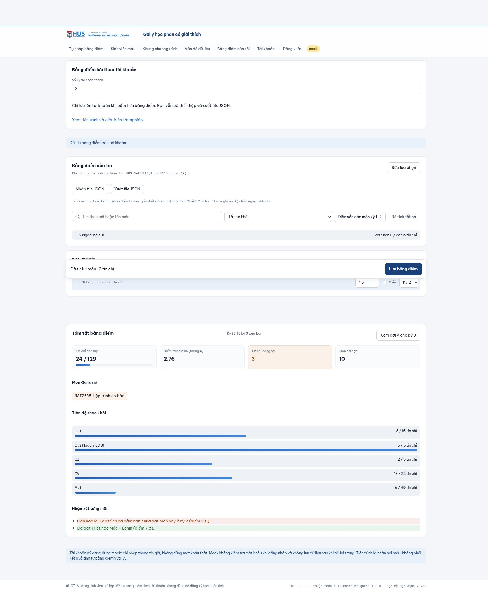
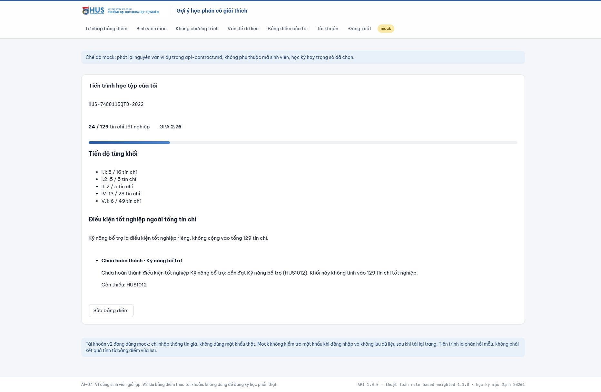

# WEB-9–11 — bằng chứng issue #64

## Phạm vi và phụ thuộc

Nhánh `feat/web-v2-account-transcript` dựa trên `docs/hop-dong-v2` (PR #65,
commit 5ee2737), main nền b2dea13. PR này chỉ triển khai web và khôi phục script;
không triển khai backend auth (#62), schema (#61), luật (#63), plans/admin hay chat.
Review hợp đồng: [web-v2-contract-review.md](web-v2-contract-review.md).
Đề xuất xử lý PR #59: [web-chat-scope.md](web-chat-scope.md), chưa phải đồng thuận nhóm.
Prompt và các quyết định kiểm chứng: [WEB-9-11-v2.md](../prompts/WEB-9-11-v2.md).

## Vị trí thay đổi

| Yêu cầu | Vị trí | Bằng chứng |
|---|---|---|
| WEB-9: phiên, đăng nhập, đổi mật khẩu, xóa | `src/web/src/api/v2/client.ts`, `lib/account.tsx`, `pages/AccountPages.tsx` | `v2-client.test.ts`, `account.test.tsx`: 401, return path an toàn, xác nhận bằng mật khẩu |
| WEB-10: HUS, lưu toàn bộ bảng điểm, 422/409, bản nháp | `pages/AccountPages.tsx`, `pages/TranscriptEntryPage.tsx` | Test luồng đăng ký tới lưu, đúng field lỗi, không tự xóa, import JSON và đồng ý bản nháp |
| WEB-11: tiến trình và điều kiện riêng | `pages/AccountPages.tsx` | Test credit/GPA/blocks và Kỹ năng bổ trợ tách khỏi tổng |
| Mock theo hợp đồng | `api/v2/examples.json`, `types.ts`, `mock.ts` | So sánh từng ví dụ JSON với §6; kiểm tra dữ liệu hai tài khoản không lẫn |
| Live script PR #57 | `scripts/live.*`, `scripts/smoke_transcripts.py` | `test/test_live_smoke.py`: 404, lỗi mạng và thiếu fixture đều thất bại |

Các đường dẫn web trong bảng tính từ `src/web/src/`, trừ đường dẫn đã ghi đầy đủ.

## Thử trình duyệt ngày 2026-11-28

Mock tại cổng 5175, tài khoản giả `web-v2-demo@example.test`:
đăng ký → chọn HUS-7480113QTD-2022 → lưu khung → nhập 2 kỳ,
MAT2505 điểm 7.5 kỳ 2 → lưu → xem tiến trình → đăng xuất → đăng nhập lại.
Quay lại đúng trang trước đăng xuất; mở bảng điểm vẫn thấy 2 kỳ và điểm 7.5.
Không dùng tài khoản hay mật khẩu thật. Ảnh ghi lại các màn hình sau thao tác:

## Kiểm tra và giới hạn

- Vitest: 10 file, 141 test pass.
- Lint, TypeScript/Vite build và check:api pass; kiểu v1 sinh tự động không đổi.
- pytest smoke: 4 test pass; ruff pass; PowerShell parse và bash -n pass.
- Chưa chạy Docker + API live trong lần kiểm tra này. Chưa xác minh backend v2/cookie thật.
- Mock chỉ lưu RAM, không xác thực mật khẩu; progress là fixture cố định, không tính nghiệp vụ.
  Điều này hiển thị ngay trên giao diện và README. Backend phải cung cấp kết quả thật ở #62.
- Hợp đồng v2 chưa có OpenAPI; kiểu thủ công cần thay khi hợp đồng máy đọc được sẵn sàng.
- PR phải chờ hợp đồng #65 và review tích hợp. Không tự merge thay các thành viên khác.
